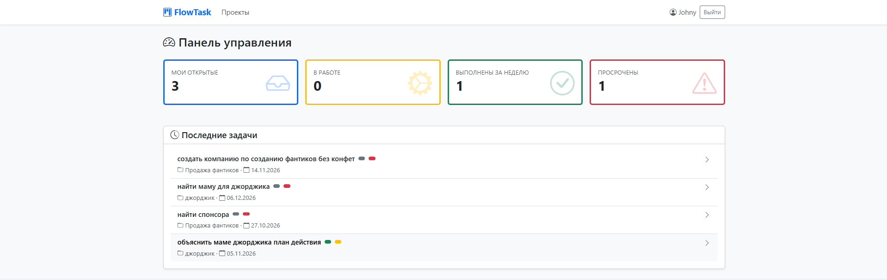
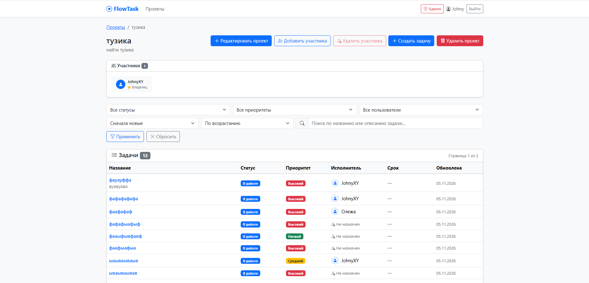

# TaskFlow 

**TaskFlow** — это современное веб-приложение для управления проектами и задачами, разработанное на FastAPI. Приложение позволяет командам эффективно организовывать работу, отслеживать статусы задач и разграничивать права доступа.

## Ключевые возможности

- **Безопасная аутентификация:** Регистрация, вход, защита маршрутов и управление сессиями через подписанные cookie (itsdangerous).
- **Ролевая модель:** Разграничение прав между гостями, участниками проектов, владельцами и администраторами системы.
- **Управление проектами и задачами:** Полный CRUD для задач и комментариев, фильтрация по статусу/приоритету, поиск и пагинация.
- **Покрытие тестами:** Более 25 автотестов (pytest + httpx), проверяющих бизнес-логику, права доступа и изолированность базы данных.

## Скриншот интерфейса

## Стек технологий

- **Backend:** Python 3.10+, FastAPI, SQLAlchemy 2.0
- **Frontend:** Jinja2 Templates, HTML5, CSS3, Bootstrap 5
- **База данных:** SQLite (для разработки/тестов), поддержка PostgreSQL
- **Безопасность:** Passlib (bcrypt), itsdangerous (подпись сессий)
- **Тестирование:** Pytest, HTTPX, Pytest-Cov

## Переменные окружения

Для работы приложения необходимо создать файл `.env` в корневой папке проекта. Пример находится в файле .env.example.

## Запуск через Docker

### Требования
- Установленный [Docker Desktop](https://www.docker.com/products/docker-desktop/)

### 🚀 Пошаговая установка

Убедитесь, что у вас установлен [Docker Desktop](https://www.docker.com/products/docker-desktop/).

#### Шаг 1. Клонирование репозитория

git clone https://github.com/GetmanWhy6478/Taskflow.git

#### Шаг 2. Переименуйте .env.example в .env и заполните своими данными

#### Шаг 3. Запустите команду:

docker-compose up --build

Эта команда:
- Скачает базовые образы Python 3.12 и PostgreSQL 15
- Установит все зависимости из pyproject.toml
- Создаст и настроит базу данных PostgreSQL
- Запустит приложение на порту 8000

#### Шаг 4. Откройте в браузере: http://127.0.0.1:8000

Готово!

